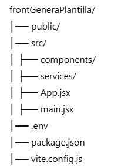
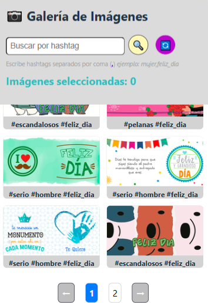
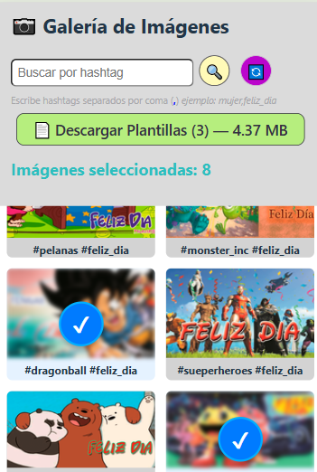
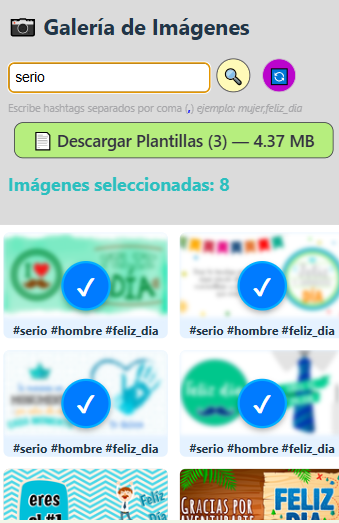
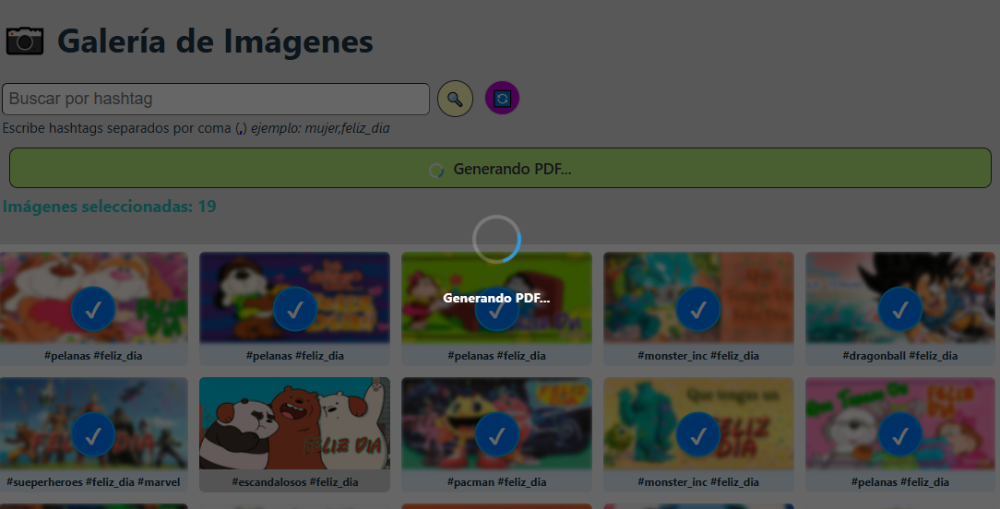
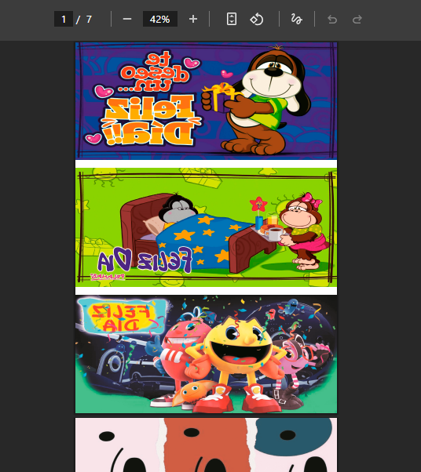

# 📷 Generador de Plantillas - Frontend

## Aplicación frontend construida con **React + Vite**, desplegada en **Netlify**, que permite visualizar imágenes, filtrarlas por hashtags y generar plantillas en PDF.

### 🔹 Tipo de arquitectura

👉 Es una arquitectura distribuida basada en microservicios / servicios independientes:

Frontend (Netlify) → es un cliente SPA (React) que consume APIs.

Backend (Render) → servicio independiente que expone un API REST.

Database (Supabase) → gestionada como servicio independiente (DBaaS).

Storage / Cache (Service Worker) → manejado en el navegador, como mecanismo de optimización.

📌 Esto se parece mucho a un modelo Jamstack + Backend desacoplado:

Jamstack porque el frontend se despliega como estáticos en Netlify.

Backend desacoplado porque la API vive aparte en Render.

DBaaS (Supabase) como otro servicio administrado.

Patrón de diseño

👉 Lo que aplicaste es una arquitectura de microservicios distribuida con:

Separación de responsabilidades (SoC).

Patrón Backend for Frontend (BFF): el backend en Go responde de forma específica a las necesidades del frontend.

Cache-Aside Pattern: el frontend mantiene en caché los recursos (imágenes) para reducir llamadas cuando el backend está “dormido”.

---

## 🚀 Características
- 🔍 Búsqueda por hashtag
- 📦 Selección múltiple de imágenes
- 📄 Generación de PDFs con las imágenes seleccionadas
- 🎨 Responsive Design (mobile-first)
- ⚡ Desplegado en **Netlify**

---

## 📂 Estructura del proyecto

---

## ⚙️ Instalación local
1. Clonar el repositorio:
   git clone https://github.com/tuusuario/frontGeneraPlantilla.git
   cd frontGeneraPlantilla

2. Instalar dependencias:
    npm install

3. Configurar variables de entorno en .env:
    VITE_API_URL=https://back-tazas-generador.onrender.com

4. Levantar el servidor:
    npm run dev

👉 Abre http://localhost:5173

🌍 Despliegue en Netlify

Build Command: npm run build

Publish Directory: dist

Variables de entorno:

🌍 Despliegue en Netlify

Build Command: npm run build

Publish Directory: dist

Variables de entorno:

VITE_API_URL=https://back-tazas-generador.onrender.com

   

🛠️ Tecnologías utilizadas

React + Vite

JavaScript (ES6+)

CSS Grid + Media Queries

Netlify
